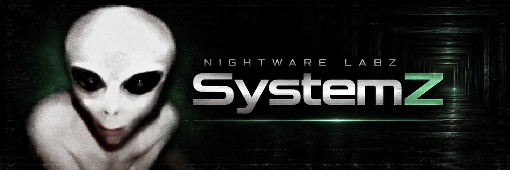

# SystemZ

SystemZ is a hypervisor-based operating system for x86_64 computers, built
entirely from scratch on our own concepts — no borrowed hypervisor, no
borrowed kernel, no borrowed bedrock.

Primarily a **developer's operating system**: a machine made for building
all types of development projects. Its minimal core is system
administration and networking. Everything else is a brick — versioned,
signed, swappable — in a system that describes itself, updates itself from
inside itself, and isolates everything by default.

Insanely fast. Insanely moddable. Insanely powerful. Insanely secure.

**Status:** founding specification — see [SPEC.md](SPEC.md). No code yet;
every state claim in this repo is proven or labelled unproven.

## The shape

- **ZCore** — a microhypervisor in Rust (`no_std`, zero external
  dependencies), with C at the key seams — the loader/firmware path,
  the brick ABI, CPU plumbing, driver class interfaces — for maximum
  capability and universality: vCPU scheduling, EPT/NPT memory
  isolation, interrupt routing, inter-domain messaging. Four jobs,
  nothing else. Every brick interface is a C header, so bricks can be
  written in any language.
- **Domains** — admin, network, firewall, update, and developer project
  domains, each isolated, each talking over the ZBus, each replaceable.
- **Bricks** — every component is a signed, content-hashed, versioned
  unit stored in a self-healing replication tree. Swap any piece; the
  system re-solves and boots a new generation.
- **Generations** — the whole machine is one declarative description.
  Updates are atomic new generations with trial boot and automatic
  rollback.

## Target: the x86_64 architecture

One logic, every machine: x86_64 with VT-x/EPT (or AMD-V/NPT) and an
IOMMU (VT-d / AMD-Vi). No per-model targets — hardware is discovered at
runtime (CPUID, ACPI, PCI enumeration) and drivers are written by
device class (AHCI/NVMe, xHCI, NIC classes), never for a machine model.
Any specific computer is only a witness where universal claims get
proven.

## The house, plugged in

SystemZ is composed from the house's own work: **Comigen (C35)** is
its designated main graphics engine, **orc** its designated browser
system, and every other house utility — nightwire, nightjar, the
Blacksite benches, phantom, Magic Box, orange, snoot, and the rest —
has a named home in the architecture. The census, the integration
forms, the earliest milestone that can absorb each piece, and its
honest status today live in [INTEGRATION.md](INTEGRATION.md). Nothing
on that map is integrated yet; it records designations and the order
they can arrive in.
