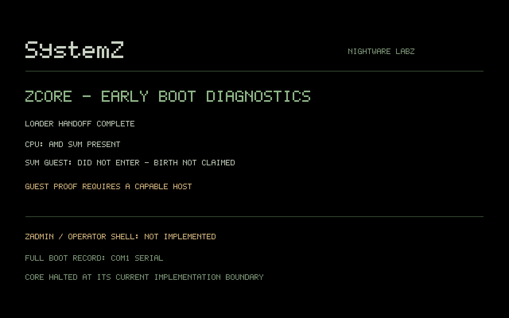
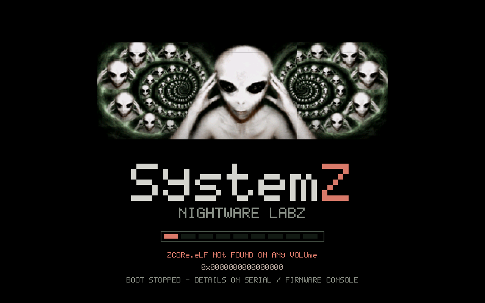

# Live boot splash — emulator witness

The checked-in screenshots were captured from the **actual running EFI
loader and Rust ZCore** with QEMU's QMP `screendump`. They are not generated
design mockups. The five serial logs are the corresponding real boot runs.

- Source commit: `6d9605a03769312ea01f7d407c4749e283312f71`
- Tested PR merge: `94d71f4f9c87b63b7d2c2373f0b27640c3f1d65d`
- [Passing workflow run](https://github.com/nightwarelabz/SystemZ/actions/runs/40820509224)
- [Compiled EFI/ZCore, logs, captures and renderer preview](https://github.com/nightwarelabz/SystemZ/actions/runs/40820509224/artifacts/12874765983)
- Environment: Ubuntu 24.04 runner, QEMU 8.2.2 TCG, OVMF 2024.02,
  q35, 256 MiB RAM, `-cpu max`; normal GOP mode 1280x800 BGRX.

| Witness | Result |
|---|---|
| Native renderer | ASan/UBSan passed: five resolutions, RGBX/BGRX/masks, guards and stride padding |
| Builds | Freestanding PE32+ UEFI application and Rust bare-metal ZCore built |
| Normal boot | v2 framebuffer passed into ZCore; live splash replaced by actual diagnostics |
| Missing ZCore | Loader stopped visibly with failure state; no kernel entered |
| Invalid ZCore | ELF validation stopped visibly; no kernel entered |
| No GOP | Firmware text and serial fallback; ZCore still reached |
| Escape | Firmware details selected; graphical handoff disabled for that boot |

The CPU/guest report deliberately preserves the existing proof boundary:
this QEMU TCG run did **not** execute the SVM guest, and the diagnostic screen
says so. Neither an operator shell, a complete OS, guest isolation, nor a
physical-hardware boot is claimed. The raw logs retain firmware escape
sequences. `renderer-preview.mp4` is a labelled host-renderer demonstration,
not a recording of the real QEMU boot.

## Actual ZCore handoff

## Actual missing-kernel failure

Reproduce with the commands in [boot/README.md](../../boot/README.md).
